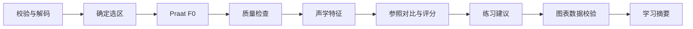

# 声调纠正项目 · 声调纠正系统

浏览器录音 → 回听与选区 → Praat 自动提取 F0 → 声学特征与图表 → 教学反馈 → 复练对比。面向汉语二语学习者，首版支持孤立一至四声，重点观察二声、三声。用户已明确需要录音，本项目不引入语音识别。

前端为响应式 HTML/CSS/ES Modules，无构建步骤。后端为 FastAPI、Praat-Parselmouth、SQLAlchemy；服务器部署使用 PostgreSQL、Redis、Celery 与 Caddy HTTPS。本地开发使用 SQLite 和进程内后台任务。可把独立录音模块迁移到 React/assistant-ui。

## 已实现功能

首页提供“游客立即试用”，无需账号、密码或邀请码即可体验录音、Praat 分析、示范音、图表、教学问答和 memory。每个浏览器获得独立的 HttpOnly 试用会话，有效 24 小时；过期后由每小时清理任务删除游客账号、录音、对话和练习摘要。游客可进入正式登录/注册入口，教师初始化与邀请码权限保持独立。公开试用按会话及请求来源限制分析与问答次数，正式账号沿用原有流程。

- 网页录音、实时音量、15 秒自动停止、权限取消、回听、重录、音频上传和下载。
- WebM/Opus、MP4/AAC、OGG 等格式动态探测；后端 FFmpeg 真实解码。
- 自动建议发音选区、手动起止调整、可配置 F0 范围、质量提示。
- 振幅波形、F0 曲线、最低点标记、同声调复练对比与 CSV 导出。
- 声调轮廓分、同参照分数历史、真人标准曲线对照、雷达图、分段偏差和 RMS 音量图。
- 专业课程示范音回听、教师上传示范、保留本人音色与时长的 Praat 声调重合成播放。
- 教师/学习者账号、单次邀请码、登录会话、练习数据隔离、授权教师查看。
- 服务器历史记录和录音回听，练习与对话删除。
- 教学问答、知识检索、可配置的 OpenAI 兼容模型 API；无密钥时明确使用本地规则。
- skills、代码强制执行的 harness、短期对话记忆与可控长期学习记忆。
- Docker Compose 部署、健康检查、音频保留期清理、备份脚本与 GitHub Actions 检查。

## 快速本地运行

### Windows E 盘运行

将源码放在 `E:\tone-correction-project`，需要 Python 3.12。在 PowerShell 中执行：

```powershell
cd E:\tone-correction-project
powershell -NoProfile -ExecutionPolicy Bypass -File scripts/windows.ps1 Install
.\start.cmd
```

若 Python 3.12 不在 PATH 中，安装时增加 `-PythonPath "Python 3.12 的完整路径"`。
脚本创建 Windows `.venv`，安装项目依赖以及 imageio-ffmpeg 0.6.0 提供的 Windows FFmpeg；缓存和临时文件位于 `runtime`。本次本机部署额外在 `runtime/python` 放置独立 Python 3.12 运行时，全部位于 E 盘。运行时不加入源码仓库。

访问 [http://localhost:8000](http://localhost:8000)。双击 `start.cmd` 启动后台服务，`stop.cmd` 停止。停止前等待当前分析结束。`backup.cmd` 会暂停服务、压缩完整 `data` 目录，再恢复原来运行状态。`scripts/windows.ps1 Status` 查询运行情况。

本机入口固定使用 SQLite 和进程内分析：数据库是 `E:\tone-correction-project\data\tone_correction.sqlite3`，每次练习的原始录音和解码 WAV 位于 `data\practices\<练习ID>\source.audio` 与 `audio.wav`。日志在 `logs`，私有备份在 `backups`。Docker 模式的命名卷由 Docker Desktop 管理，不由本机入口使用。

安装自动生成 `.env` 随机秘密，启动显式使用 Uvicorn `--env-file` 加载。首次教师注册需填写 `.env` 的 `SETUP_TOKEN`；没有默认账号密码。DeepSeek 默认配置为 `LLM_BASE_URL=https://api.deepseek.com`、`LLM_MODEL=deepseek-v4-pro`，对应 [DeepSeek 官方接口文档](https://api-docs.deepseek.com/)。`LLM_API_KEY` 留空时明确使用本地教学规则。获取真实密钥后仅在本机 `.env` 填写并重启，才可进行实际 API 联调；录音不发送给文本模型。

Windows 入口仅监听 `127.0.0.1:8000`。手机与学校域名的 HTTPS 部署另按下节配置。

### Linux 本地运行

需要 Python 3.12、FFmpeg，以下命令在项目根目录执行：

```bash
python -m venv .venv
.venv/bin/python -m pip install -r requirements.txt
.venv/bin/python scripts/configure.py
.venv/bin/python -m uvicorn backend.main:app --env-file .env --host 127.0.0.1 --port 8000
```

访问 [http://localhost:8000](http://localhost:8000)。首次访问使用 `.env` 的 `SETUP_TOKEN` 创建教师账号，密码至少 10 个字符。未设置 `SETUP_TOKEN` 时，仅允许从服务器 loopback 初始化。教师可以在“教师工作台”生成学习者邀请码。

localhost 可以请求麦克风；通过手机访问 HTTP 服务器 IP 通常不能录音，需使用 HTTPS。教师可查看通过其邀请码注册的学习者练习；其他学习者之间的音频、练习、对话和记忆相互隔离。

## 学校或个人服务器部署

建议小规模试点从 4 核 CPU、8 GB 内存、100 GB SSD 起步；容量需按实际并发测试。无需本地 GPU。

```bash
python scripts/configure.py
```

脚本创建权限为 0600 的 `.env`，生成随机数据库密码与初始化口令，不输出秘密、不覆盖现有配置。编辑该文件，填写指向服务器的 `SITE_ADDRESS`；模型问答需要填写 `LLM_BASE_URL`、`LLM_MODEL` 与 `LLM_API_KEY`。

```bash
docker compose up --build -d
docker compose --profile https up -d
```

应用、worker、beat、PostgreSQL、Redis 共五个服务；HTTPS profile 增加 Caddy。80/443 端口需要可达，证书签发依赖域名解析和证书服务连接。校内域名应由学校配置受信任证书及反向代理。应用端口只绑定服务器 loopback，数据库和 Redis 不开放主机端口。

首次远程注册教师账号时输入 `.env` 中的 `SETUP_TOKEN`。账号密码由用户设置，本项目没有固定默认密码。通过 HTTPS 代理访问会使用 Secure 登录 cookie；不要在公开代理前暴露应用端口。

### 公网 IP 的 HTTPS 入口

使用 Caddy 2.11.7 及以上版本，可在服务器私有 `.env` 中设置 `SITE_ADDRESS=你的公网IPv4`（只填一个 IP，不带协议和端口）以及 `CADDY_CONFIG_FILE=./Caddyfile.ip`，再执行 `docker compose --profile https up -d --no-deps caddy`。通过 `https://公网IPv4` 访问，前端和 API 共用同一来源，支持浏览器录音及 Secure 会话。

`Caddyfile.ip` 显式使用 Let's Encrypt 的 `shortlived` 公网 IP 证书，通过 TCP 80 完成 HTTP-01 验证，并给不发送 SNI 的 IP 客户端选择正确证书。证书有效期约 160 小时，由 Caddy 自动续期；`caddy_data` 卷持久保存证书和 ACME 账户，Caddy 容器自动重启。TCP 80/443 应保持可达。配置完成后，用 `curl --fail https://公网IPv4/api/health` 验证受信任的 HTTPS，浏览器地址栏应无证书警告。回到域名入口时，将以上两项改回域名和 `./Caddyfile`，重新启动 Caddy 服务。大陆服务器的备案要求仍适用。

当前受代理管理的云环境构建镜像时可挂载完整 CA 包，保持 TLS 校验：

```bash
docker build --secret id=proxy_ca,src=/etc/ssl/certs/ca-certificates.crt -t tone_correction-tone-lab .
```

普通服务器不需要该参数。不要将环境代理 CA、模型密钥或数据库备份加入仓库。

## Skills、Harness 与 Memory

每次录音完成声学分析后，页面展示 F0 曲线、有效帧比例、前中后段音高、同声调复练变化和三步练习图示。智能体直接在对话里解释发音特点、关键证据和下一轮动作，不生成报告。字体与图表标签采用较深颜色，并提供手机网页布局。

`scientific-response` 和 `anti-defensive-writing` 是每次教学回复的强制 skill。服务器 chat harness 按权限校验 → 计算证据 → 加载回复规范及资料 → 生成分析与建议 → 校验事实与表述 → 保存执行；记录所加载 skill 的实际哈希，禁止跳步。保存前删除泛泛的自我削弱表述；无依据的声学数值或教学结论回退到实测练习建议。`POST /api/chat/stream` 按实际步骤发送状态，页面流程图逐步点亮，显示完成时间或失败位置；不以动画伪造运行进度。

使用 DeepSeek V4 Pro 时设 `LLM_MODEL=deepseek-v4-pro`。可通过 `LLM_REASONING_EFFORT=high`、`LLM_MAX_TOKENS=8192`、`LLM_TIMEOUT_SECONDS=120` 调整解读预算。DeepSeek 请求启用思考模式，但页面展示可核对的测量和结论，不展示模型内部推理文本。来源：[DeepSeek 接口文档](https://api-docs.deepseek.com/api/create-chat-completion/)。

`skills/manifest.json` 注册分析与教学技能；各目录的 `SKILL.md` 定义输入、职责和限制：

| Skill | 职责 |
|---|---|
| recording-quality | 格式、边界、音量、削波与缺失检查 |
| praat-f0 | 固定版本的 F0 提取与参数记录 |
| tone-analysis | 计算、解释声学观测特征 |
| tone-teaching | 根据资料提供具体教学建议 |
| chart-data | 校验波形/F0 数据与轴单位 |
| learning-memory | 按账号记录和召回学习事实 |
| scientific-response | 强制规范科学回复结构、图表解释、依据引用和复练实验 |
| anti-defensive-writing | 强制检查直接、具体、有证据的教学表述 |
| tone-scoring | 版本化参照对比、轮廓分和同条件复练记录 |

分析 harness 在代码中强制以下顺序，不能由模型跳过或重新排序：



每一步保存技能文件哈希、开始/结束时间、状态与结果摘要。录音区的流程图展示九个声学步骤，随后展示六个教学步骤。模型请求期间显示实际阶段、已用时间和等待动画，不显示虚构百分比。失败步骤保留原因，下游步骤不执行。

教学问答按会话权限 → 分析和记忆 → 教学 skill 与资料检索 → 模型/本地回答 → 输出检查 → 对话保存执行。模型解释服务器计算的测量、轮廓分与同参照变化，不接收任意客户端数值；录音不发送给文本模型。数值校验拦截模型编造的分数和诊断表述。

短期记忆来自当前会话最近十条消息；长期记忆来自可编辑学习目标与最近二十次确定性练习摘要，带来源 `practice_id` 和算法版本。不从一次录音推断稳定能力或疾病。用户可以关闭长期记忆、清空摘要，删除练习会同步删除对应摘要。关闭后不向模型发送长期记忆、不写入新摘要。

## 数据与声学边界

- 录音先留在页面，点击分析才上传。网络失败仍可重试或下载；刷新页面前未提交的音频可能丢失。
- 后端限制 12 MB、30 秒，使用 FFmpeg 解码，文件名和 MIME 不作为真实性证据。仅允许本地文件/管道协议并限制转换时间。
- 未指定选区时按能量建议起止。此方法不是音节强制对齐，重复发音、噪声和复杂声母需要人工检查。
- Praat 采用 10 ms 步长，保留实际帧时间和选区偏移。未发声帧为 `null`，曲线断开；不跨缺失区间插值，不自动改写倍频跳变。
- 波形纵轴为振幅，F0 纵轴为 Hz。对比图按各自选区归一化时间；CSV 保留真实时间。
- 当前观测包含选区时长、首尾有效 F0 跨度、起止/最低/最高/平均 F0、最低点位置及首尾半音差。选区时长、最低点不直接等同论文中的发声时长和 TP。
- 锁定 Parselmouth 0.4.7（内置 Praat 6.1.38）及 raw autocorrelation。与新版桌面 Praat 比较时必须匹配版本、方法和参数。
- 原始及解码音频保存于私有数据卷，默认 30 天后清理；结构化结果保留，用户可主动删除。`AUDIO_RETENTION_DAYS` 可配置。
- 数据库初始化使用 `create_all`，用于首次安装。后续改变已部署的 schema 需要编写迁移并先备份，不能将 `create_all` 当作迁移工具。

轮廓分是可复算的参照匹配指标：75% 归一化轮廓贴合 +25% 分段升降方向，方法版本 `contour-1.0`。音域按本次第 10–90 百分位半音值归一化，最小跨度 2 半音；该跨度和权重为系统规则。分数用于孤立声调复练，采用相同参照及参数比较变化，考试等级和真实学习效果需要标注语料验证。连续语流、轻声与三声变调另行处理。

专业示范来自 [英国开放大学 OpenLearn 的四声课程](https://www.open.edu/openlearn/mod/oucontent/view.php?id=106435&section=2)，按原声顺序截取 mā、má、mǎ、mà，并用 Praat 提取实际曲线。参考音及其曲线保留 The Open University (2020) 署名，许可为 [CC BY-NC-SA 4.0](https://creativecommons.org/licenses/by-nc-sa/4.0/)，[课程许可说明](https://www.open.edu/openlearn/mod/oucontent/view.php?id=106436&section=__acknowledgements)。它们的许可独立于本仓库代码的 GPL-3.0-or-later。公开源码在 `backend/reference_audio` 中包含四个公开许可的单音节示范及署名文件，服务可直接播放；私人录音仍只存放在 `data`，不进入仓库。若要重新提取示范，从课程的下载链接取得 `l197-pronunciation-10a.mp3`，执行 `python scripts/import_reference_audio.py --source "下载文件的完整路径"` 导入。

纠正示范对本人的已保存单音节录音做 Praat PSOLA 声调重合成，按参照调整 F0 并保留音色和时长；产物与原录音一同保留或删除。[Parselmouth 方法说明](https://parselmouth.readthedocs.io/en/stable/examples/pitch_manipulation.html)。RMS 图以 dBFS 表示数字录音音量。

## 接口

| 接口 | 功能 |
|---|---|
| `/api/auth/*` | 登录、注册、退出、教师邀请码 |
| `POST /api/analyses` | 上传并排队，返回练习 ID |
| `GET /api/practices/{id}` | 查询状态、harness 进度与结果 |
| `GET /api/practices` | 本人练习记录 |
| `/api/practices/{id}/audio` | 授权回听 WAV |
| `/api/practices/{id}/export` | 导出 F0 CSV |
| `DELETE /api/practices/{id}` | 删除练习、音频和对应摘要 |
| `/api/memory` | 查看、修改、关闭及清空记忆 |
| `/api/conversations/*` | 服务端对话历史 |
| `POST /api/chat` | skill/知识/记忆驱动的教学问答 |
| `/api/teacher/students/*` | 授权教师查看学习者练习 |
| `/api/agent/config` | 查看技能与流程配置 |

multipart 分析字段为 `file`、`tone`、`pitch_floor`、`pitch_ceiling`，可选 `start_s/end_s`。完整接口文档在登录服务的 `/docs`。

## 验证和备份

```bash
python -m unittest discover -s tests -p 'test_*.py' -v
node --test tests/recorder.test.mjs
```

测试使用独立临时数据库，不访问生产数据。覆盖已知频率、静音、WebM/M4A、时间偏移、输入异常、账号隔离、教师权限、会话、记忆控制、harness 顺序、模型 prompt 和录音资源释放。

可选浏览器检查需要 Playwright 与 Chromium，先运行本地服务。`tests/browser.cjs` 使用合成音虚拟麦克风检查录制、回听、Praat、流程状态、问答、记忆、复练、刷新恢复和手机宽度布局。它不能替代真实 iOS/Android/麦克风验收。

```bash
sh scripts/backup.sh ./backups
```

备份包含数据库和私有音频，应妥善保存，不能提交到公开仓库。保留配置与 schema 版本；恢复前停止写入，再按学校的备份恢复流程操作。单机部署当前无跨主机高可用配置。

## 项目状态与参考

源码实现了完整录音教学闭环及部署配置。模型 API 真实联调、学校服务器/域名上线、真实设备和学习者效果验收依赖实际配置与语料。用户提到的 cetagent 项目尚未定位，本录音模块使用浏览器原生 API 独立实现。

- [MediaDevices.getUserMedia](https://developer.mozilla.org/en-US/docs/Web/API/MediaDevices/getUserMedia)
- [MediaRecorder.stop](https://developer.mozilla.org/en-US/docs/Web/API/MediaRecorder/stop)
- [MediaRecorder.isTypeSupported](https://developer.mozilla.org/en-US/docs/Web/API/MediaRecorder/isTypeSupported_static)
- [Praat-Parselmouth](https://github.com/YannickJadoul/Parselmouth)
- [Praat pitch methods](https://www.fon.hum.uva.nl/praat/manual/how_to_choose_a_pitch_analysis_method.html)
- Zhang, H., Wang, Z., & Liu, W. (2025). *Effect of speaker variability on tone perception for L2 learners: Perspectives of machine learning*. [DOI](https://doi.org/10.1121/10.0037073)

## 许可

项目采用 GPL-3.0-or-later，见 `LICENSE`。Praat-Parselmouth 使用 GPL-3.0-or-later；分发镜像或软件时保留第三方许可并满足适用源代码义务。论文原文、私人录音、账号信息、模型密钥不包含在源码分发中。
